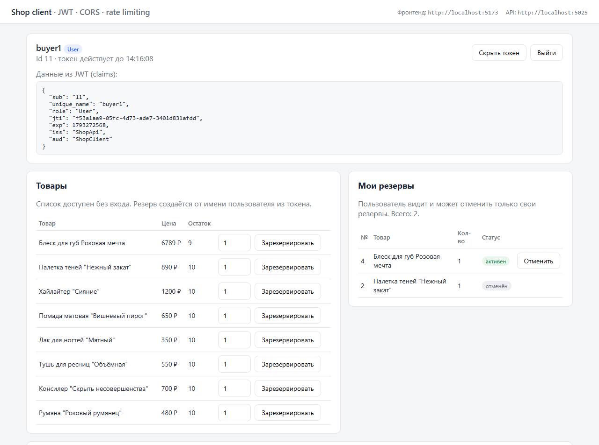
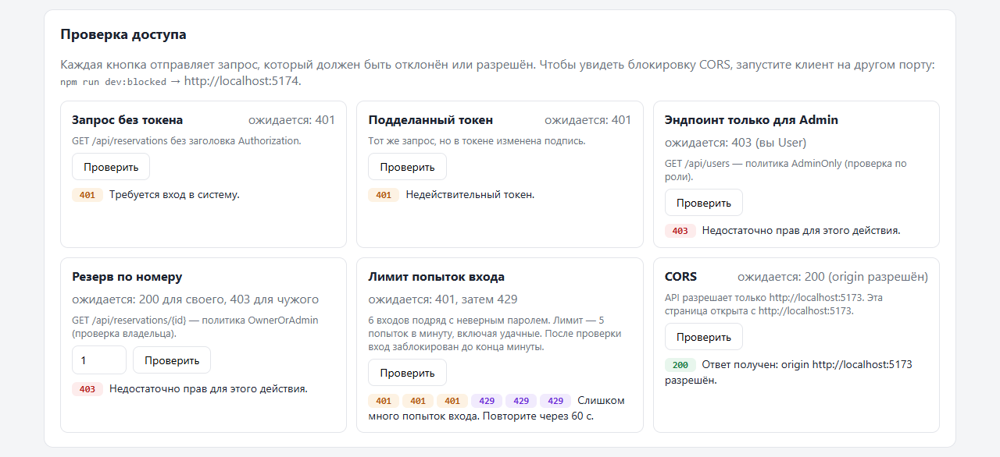
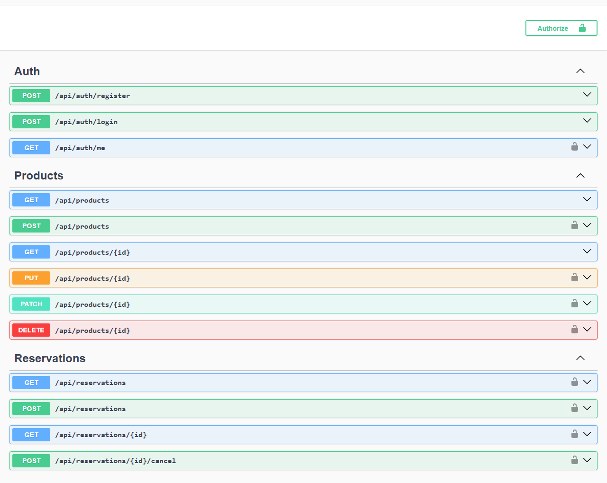
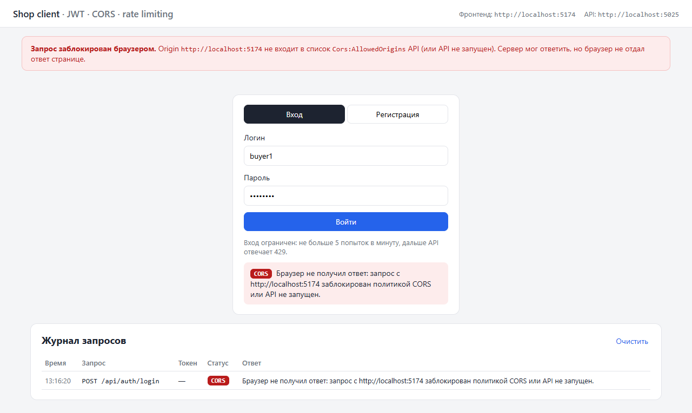

# aspnet-shop-api

REST API интернет-магазина на ASP.NET Core с JWT-аутентификацией и React-клиентом · *Online shop REST API on ASP.NET Core with JWT auth and a React client*

`C#` `.NET 8` `ASP.NET Core Web API` `EF Core 9` `SQL Server` `AutoMapper` `JWT` `Swagger` `React` `Vite`

| React-клиент | Проверки доступа |
|---|---|
|  |  |

| Swagger: замок только у защищённых методов | Запрос с неразрешённого origin |
|---|---|
|  |  |

## Что сделано
- **Многослойная архитектура:** Controller → Service → Repository → EF Core
- **Обобщённый CRUD без дублирования:** `CrudController<TRead, TCreate, TUpdate, TPatch>`, `CrudService<…>` и `Repository<T>`. Контроллер конкретной сущности занимает одну строку
- **Полный набор HTTP-методов:** `GET` (список и по id), `POST`, `PUT`, `PATCH` (частичное обновление), `DELETE`
- **Пагинация:** параметры `page` и `pageSize` (1–100) с валидацией, общее количество записей отдаётся в заголовке `X-Total-Count`
- **DTO** для чтения, создания, обновления и патча у каждой сущности, маппинг через AutoMapper, валидация через `[Required]`, `[MaxLength]`, `[Range]`
- **`ServiceResult`:** сервис возвращает статус (`NotFound`, `Conflict`, `Invalid`, `Unauthorized`, `Forbidden`), а базовый контроллер превращает его в правильный HTTP-ответ
- **Бронирование товаров:** проверяется наличие на складе и активность пользователя, остаток списывается при бронировании и возвращается при отмене

### Безопасность
- **Пароли** хешируются через `PasswordHasher<User>` (PBKDF2 с солью), открытый пароль нигде не хранится
- **JWT:** `POST /api/auth/register` и `POST /api/auth/login` выдают access-токен с claims `sub` (Id), `unique_name` и `role`. Проверяются подпись, издатель, аудитория и срок действия
- **Ключ подписи** не хранится в репозитории: локально он лежит в User Secrets, в Development без ключа генерируется временный, в Production приложение без ключа не запустится
- **Политика по роли `AdminOnly`:** создавать, менять и удалять товары и категории может только Admin; пользователи, роли, заказы и корзины доступны только Admin
- **Политика по владельцу `OwnerOrAdmin`:** собственные `OwnerOrAdminRequirement` и `AuthorizationHandler<OwnerOrAdminRequirement, IOwnedResource>`. Пользователь видит и отменяет только свои брони, Admin — любые. Бронь создаётся от имени пользователя из токена
- **CORS** разрешён только для origin из `Cors:AllowedOrigins` (по умолчанию `http://localhost:5173`)
- **Rate limiting на входе:** 5 попыток в минуту с одного IP, дальше `429` с заголовком `Retry-After`
- **Понятные ошибки:** `401`, `403` и `429` возвращают JSON с сообщением, а не ошибку сервера
- **Swagger:** кнопка Authorize, замок и ответы 401/403 только у методов, которые требуют токен

## Доступ к эндпоинтам
| Ресурс | Путь | Доступ |
|---|---|---|
| Вход и регистрация | `POST /api/auth/login`, `POST /api/auth/register` | все (вход — с лимитом) |
| Текущий пользователь | `GET /api/auth/me` | с токеном |
| Товары, категории | `/api/products`, `/api/categories` | чтение — все, изменение — Admin |
| Бронирования | `/api/reservations`, `POST /api/reservations/{id}/cancel` | с токеном; чужие брони — только Admin |
| Пользователи, роли | `/api/users`, `/api/roles` | Admin |
| Заказы, корзины | `/api/orders`, `/api/order-items`, `/api/carts`, `/api/cart-items` | Admin |

## React-клиент (`client/`)
Отдельное приложение на своём origin. Нужно, чтобы проверить CORS: Swagger и Postman его не проверяют, это делает только браузер.
- вход и регистрация, токен хранится в `localStorage` и отправляется в заголовке `Authorization: Bearer`
- список товаров, бронирование, список и отмена своих броней
- блок проверок: запрос без токена (401), подделанный токен (401), эндпоинт для Admin (403), чужая бронь (403), лимит входа (429), CORS
- журнал всех запросов со статусами

## Структура
```
Auth/                       # политики, requirement и handler владельца, JWT, rate limiting, фильтр Swagger
Controllers/
├── ApiControllerBase.cs    # общая валидация пагинации, X-Total-Count, ServiceResult → HTTP-ответ
├── AuthController.cs       # регистрация, вход, текущий пользователь
├── CrudController.cs       # обобщённый CRUD-контроллер
├── EntityControllers.cs    # контроллеры сущностей (по одной строке)
├── ProductsController.cs
└── ReservationsController.cs
Services/                   # CRUD-сервисы, ReservationService, AuthService, TokenService, AdminSeeder
Repositories/               # IRepository/Repository, репозитории сущностей, IUserRepository
DTOs/                       # DTO для каждой сущности и для аутентификации
Mapping/MappingProfile.cs   # правила AutoMapper
Models/                     # сущности EF Core, ShopDbContext
Database/                   # SQL-скрипты: бронирования, расширение password_hash
client/                     # React + Vite
```

## Запуск
1. Укажи `connectionString` в `appsettings.json` (по умолчанию `localhost\SQLEXPRESS`, БД `ShopDb`) и выполни `Database/AddReservations.sql` и `Database/AddAuth.sql`.
2. Задай ключ подписи JWT и учётную запись администратора (хранятся вне репозитория):
   ```bash
   dotnet user-secrets set "Jwt:Key" "<случайная строка не короче 32 символов>"
   dotnet user-secrets set "Seed:AdminUsername" "admin"
   dotnet user-secrets set "Seed:AdminPassword" "<пароль администратора>"
   ```
   Без ключа в Development API запустится с временным ключом, но токены перестанут действовать после перезапуска. Администратор создаётся при старте, если его ещё нет.
3. Запусти API (`http://localhost:5025`, Swagger — `/swagger`):
   ```bash
   dotnet run --launch-profile http
   ```
4. Запусти клиент (`http://localhost:5173`):
   ```bash
   cd client
   npm install
   npm run dev
   ```
   Чтобы увидеть блокировку CORS, запусти клиент на неразрешённом порту: `npm run dev:blocked` → `http://localhost:5174`.

---

## English

A layered REST API for an online shop built with ASP.NET Core, secured with JWT and policy-based authorization, plus a separate React client.

### Features
- **Layered architecture**: Controller → Service → Repository → EF Core
- **Generic CRUD with no duplication**: `CrudController<TRead, TCreate, TUpdate, TPatch>`, `CrudService<…>`, `Repository<T>`; each entity controller is a single line
- **Pagination** with a total count in the `X-Total-Count` header, DTOs with AutoMapper and validation
- **Product reservations**: stock is reduced on reserve and restored on cancel

### Security
- **Password hashing** with `PasswordHasher<User>`
- **JWT bearer auth**: register and login return an access token with the user id and role; signature, issuer, audience and lifetime are validated
- **Signing key** is kept out of the repository (user secrets); Development falls back to a temporary key, Production refuses to start without one
- **Role-based policy** `AdminOnly` and **resource-based policy** `OwnerOrAdmin` with a custom requirement and `AuthorizationHandler<TRequirement, TResource>`: users can view and cancel only their own reservations, Admin can manage any
- **CORS** limited to the origins in `Cors:AllowedOrigins`
- **Rate limiting** on login: 5 attempts per minute per IP, then `429` with `Retry-After`
- **Swagger** shows the Authorize button and a lock only on protected endpoints

### React client
A Vite + React app in `client/` that runs on its own origin: login and registration, reservations, and access checks that show 401, 403, 429 and a CORS block.

### Run
1. Set `connectionString` in `appsettings.json` and run `Database/AddReservations.sql` and `Database/AddAuth.sql`.
2. Set `Jwt:Key`, `Seed:AdminUsername` and `Seed:AdminPassword` with `dotnet user-secrets`.
3. `dotnet run --launch-profile http`, then open `/swagger`.
4. `cd client && npm install && npm run dev`, then open `http://localhost:5173`.
